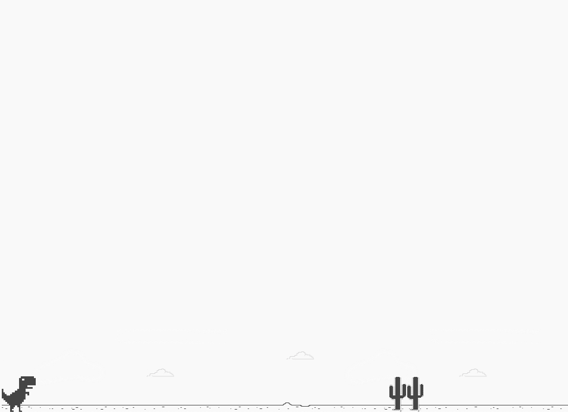

# 🦖 DIO Dino Game — O Clássico Jogo do Dinossauro do Google Chrome


<div align="center">
  
  <p><em>Tela do jogo em execução: o T-Rex correndo pelo deserto e desviando dos cactos.</em></p>
</div>

---

## 📖 Sobre o Projeto

O **DIO Dino Game** é uma recriação fiel e divertida do famoso **T-Rex Runner** (o icônico jogo offline do dinossauro do navegador **Google Chrome**), desenvolvido como parte de um desafio prático de bootcamp da **[Digital Innovation One (DIO)](https://dio.me)**.

Construído 100% com tecnologias nativas da web (**HTML5**, **CSS3** e **JavaScript puro / Vanilla JS**), o projeto demonstra na prática como criar mecânicas de jogos 2D diretamente no navegador — incluindo física de salto com gravidade simulada, animação contínua de cenário infinito, geração aleatória de obstáculos (cactos) e detecção de colisão em tempo real sem depender de nenhuma biblioteca ou engine externa.

---

## ✨ Funcionalidades

- **Cenário Infinito Animado (`background.png`):** Efeito de rolagem contínua no horizonte com nuvens e solo que simula a corrida em alta velocidade pelo deserto.
- **Física de Salto Realista (`dino.png`):** Controle de subida e descida suave do dinossauro utilizando intervalos de tempo (`setInterval`), impedindo pulos duplos no ar até que ele toque o solo novamente.
- **Geração Dinâmica de Obstáculos (`cactus.png`):** Criação e movimentação procedural de cactos em intervalos aleatórios (`Math.random`), tornando cada partida imprevisível e desafiadora.
- **Detecção de Colisão e Fim de Jogo:** Verificação contínua das coordenadas horizontais e verticais entre o dinossauro e os cactos, exibindo a tela de **Fim de Jogo (Game Over)** ao colidir.

---

## 🎮 Como Jogar

O objetivo é simples: sobreviver o máximo de tempo possível saltando sobre os cactos que surgem pelo caminho!

| Tecla | Ação |
| :--- | :--- |
| **Barra de Espaço (`Space`)** | Faz o dinossauro pular sobre os cactos |

> **Dica:** Assim que aparecer a mensagem de **Fim de Jogo**, basta atualizar a página (`F5` ou `Ctrl + R`) para iniciar uma nova corrida imediatamente.

---

## 🛠️ Tecnologias Utilizadas

O projeto foi desenvolvido utilizando apenas a tríade fundamental da web, garantindo leveza e compatibilidade total com qualquer navegador moderno:

- **HTML5 (`index.html`):** Estruturação semântica da página e contêineres do cenário e do personagem.
- **CSS3 (`style.css`):** Estilização visual, posicionamento absoluto dos elementos (`dino`, `cactus`), animação de deslocamento infinito (`@keyframes slideright`) e tipografia da tela de *Game Over*.
- **JavaScript ES6+ (`script.js`):** Captura de eventos do teclado (`keyup`), manipulação dinâmica do DOM (`createElement`, `appendChild`, `removeChild`), lógica de gravidade do salto, temporizadores assíncronos e cálculo de colisões.
- **Sprites e Assets (`*.png`):** Elementos gráficos originais do cenário (`background.png`), protagonista (`dino.png`) e obstáculos (`cactus.png`).

---

## 📂 Estrutura de Arquivos

```text
dio-dino-game/
├── index.html        # Estrutura principal da tela do jogo
├── style.css         # Estilos visuais, posicionamento e animação do deserto
├── script.js         # Lógica do salto, criação aleatória de cactos e colisões
├── dino.png          # Sprite do personagem principal (Dinossauro)
├── cactus.png        # Sprite dos obstáculos (Cactos)
├── background.png    # Imagem de fundo do deserto em rolagem contínua
├── example.png       # Ilustração / captura de tela do jogo em execução
├── LICENSE           # Arquivo da licença MIT
└── README.md         # Documentação completa do projeto
```

---

## 🚀 Como Executar o Projeto na Sua Máquina

Por ser uma aplicação front-end estática (HTML, CSS e JavaScript puro), **não é necessário instalar Node.js, servidores, bancos de dados ou pacotes adicionais** para jogar.

### Pré-requisitos

- Qualquer navegador web moderno atualizado (Google Chrome, Mozilla Firefox, Microsoft Edge, Brave, Opera ou Safari).
- **[Git](https://git-scm.com)** instalado (opcional, caso prefira clonar via terminal em vez de baixar o arquivo ZIP).

### Passo a passo

1. **Clone este repositório:**
   ```bash
   git clone https://github.com
   ```
   *(Alternativamente, clique no botão verde **Code > Download ZIP** no topo desta página no GitHub e extraia a pasta no seu computador).*

2. **Acesse a pasta do projeto:**
   ```bash
   cd dio-dino-game
   ```

3. **Inicie o jogo no navegador:**
   - **Opção 1 (Direto pelo arquivo — mais rápido):** Abra a pasta `dio-dino-game` no explorador de arquivos do seu computador e dê um **duplo clique** no arquivo `index.html` para abri-lo no seu navegador padrão.
   - **Opção 2 (Via Live Server no VS Code):** Abra a pasta do projeto no [Visual Studio Code](https://visualstudio.com), clique com o botão direito sobre o arquivo `index.html` e escolha a opção **"Open with Live Server"**.

---

## 🤝 Contribuição

Contribuições são sempre bem-vindas! Se você quiser evoluir o jogo (por exemplo, adicionando **contador de pontuação**, **recorde salvo no `localStorage`**, **aumento progressivo de velocidade** ou **efeitos sonoros**):

1. Faça um **Fork** deste repositório.
2. Crie uma **Branch** para a sua melhoria (`git checkout -b feature/NovaFuncionalidade`).
3. Faça o **Commit** das suas alterações (`git commit -m 'Adiciona contador de pontuação'`).
4. Faça o **Push** para a branch (`git push origin feature/NovaFuncionalidade`).
5. Abra um **Pull Request**.

---

## 📝 Licença

Este projeto está licenciado sob a **Licença MIT** — consulte o arquivo [LICENSE](https://github.com) no repositório para obter mais detalhes.

---

## 👨‍💻 Autor

Desenvolvido por **[marceloxm](https://github.com)** durante os estudos na **Digital Innovation One (DIO)**.

